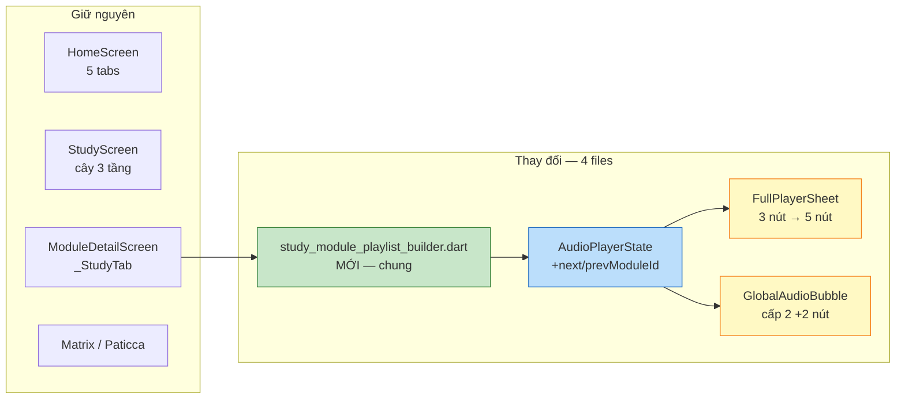
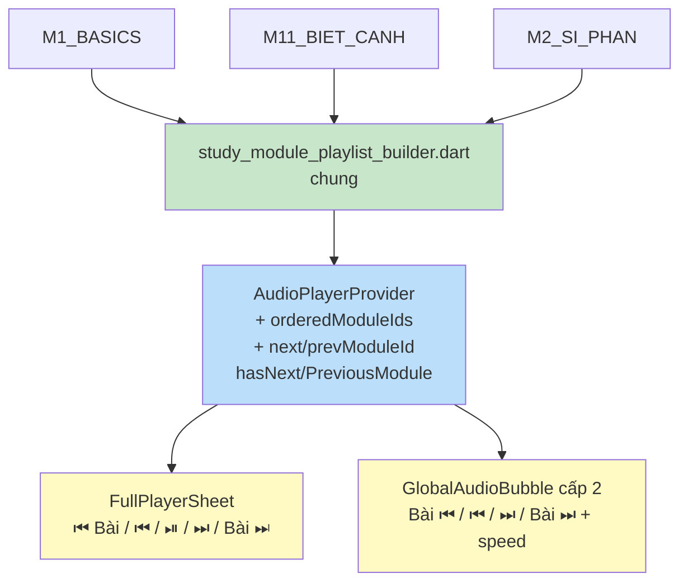
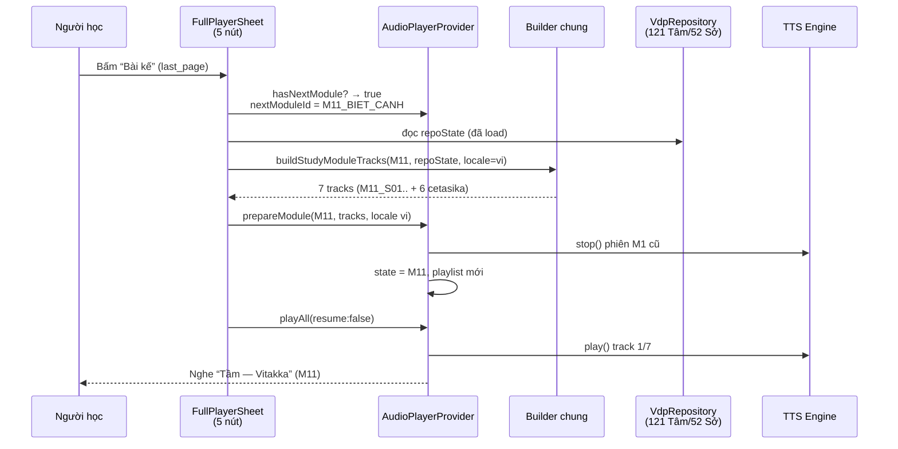
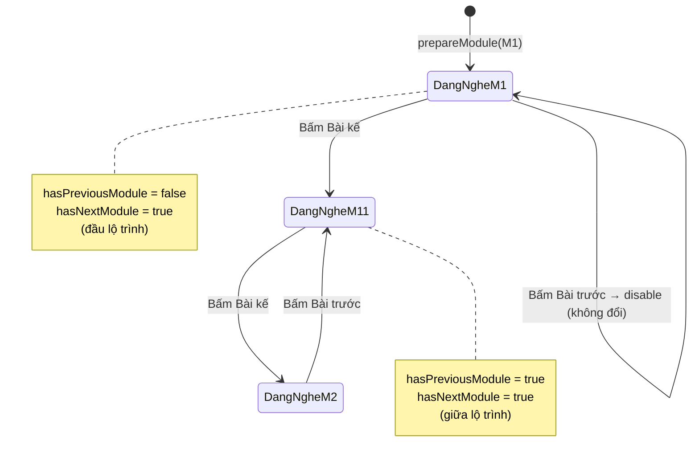

# Mô hình hoá — Phương án Nhẹ: Nút Bài trước/kế

> Nhánh: `arena/74183d76-vdp@a21b85d` (đã push) — chỉ thay đổi **trong player**, không thêm Tab.

---

## 1. Bản đồ file thay đổi (Change Map)



*Chỉ 4 files, ~374 dòng thêm — không đụng `pubspec`, không đụng `kStudyModules`, không đụng l10n.*

---

## 2. Trước vs Sau — Kiến trúc Audio

### Trước (hiện tại trên `main@dd8ccc3`)

```mermaid
flowchart TD
    M[ModuleDetailScreen<br/>M1_BASICS] --> B[_buildStudyTracks<br/>trong file]
    B --> P[AudioPlayerProvider<br/>moduleId=M1<br/>playlist=6 tracks<br/>previous()/next() chỉ index±1]
    P --> S1[FullPlayerSheet<br/>⏮ / ⏯ / ⏭]
    P --> S2[GlobalAudioBubble<br/>⏮ / ⏭ + speed]

    style P fill:#E3F2FD
    style S1 fill:#FFF3E0
```

*Hết playlist M1 → dừng. Muốn nghe M2 phải thoát M1, mở M2, bấm “Nghe toàn bộ”.*

### Sau (phương án nhẹ)



*`nextModuleId` tính từ `kStudyModules` sắp theo `recommendedOrder` (18 module).*

---

## 3. Luồng bấm “Bài kế” (Sequence)



*Nếu đang ở M1 đầu lộ trình → `hasPreviousModule=false` → nút Bài trước disable (xám, không bấm được).*

---

## 4. Trạng thái nút (State)



*Logic chỉ dùng `recommendedOrder`, không check prerequisite — đúng tinh thần “nghe nhẹ”.*

---

## 5. UI Trước/Sau — FullPlayerSheet

### Trước (3 nút)

```
┌─────────────────────────────────┐
│  Đang nghe: M1 · 2/6             │
│  “Xúc — Phassa”                 │
│                                 │
│      ⏮      ⏯      ⏭           │
│   Mục trước  Play  Mục kế       │
└─────────────────────────────────┘
```

### Sau (5 nút — bạn sẽ thấy khi mở sheet)

```
┌───────────────────────────────────────────┐
│  Đang nghe: M1 · 2/6 → M1_BASICS          │
│  “Xúc — Phassa”                           │
│                                           │
│  ⏮ Bài  ⏮    ⏯    ⏭   Bài ⏭             │
│  first  prev  Play  next  last            │
│  (xám nếu đầu/cuối lộ trình)              │
│                                           │
│  Chế độ nghe: Tịnh tiến · [chips]        │
└───────────────────────────────────────────┘
```

- `first_page` = Bài trước (module trước)
- `skip_previous` = Mục trước (track trong module)
- `last_page` = Bài kế (module kế)

### Trước/Sau — GlobalAudioBubble (khi mở rộng)

```
Trước cấp 2:
┌─────────────────────────────┐
│ ⏮  ⏭   [0.75× 1× 1.25×…]  │
└─────────────────────────────┘

Sau cấp 2:
┌──────────────────────────────────────┐
│ Bài ⏮  ⏮  ⏭  Bài ⏭   [0.75× 1×…]    │
│first  prev next last   speed chips    │
└──────────────────────────────────────┘
```

---

## 6. Không đổi gì (để bạn yên tâm)

| Giữ nguyên | Lý do |
|---|---|
| 5 tabs Home (không thêm Tab Nghe) | Tránh chật, tránh dịch 26 locale |
| `kStudyModules` + `recommendedOrder` | Không đụng data |
| `previous()/next()` trong-module | Vẫn hoạt động như cũ |
| `SharedTtsEngine` + Web tail 8s | Không đụng TTS |
| Lưu vị trí `moduleId` | Không migration |

---

## 7. Thử nhanh sau khi build

1. Mở `Học → M1_BASICS → Nghe toàn bộ`
2. Mở **FullPlayerSheet** (nút 3 chấm hoặc bubble → mở rộng)
3. Thấy 5 nút, 2 đầu là `first/last_page`
4. Bấm **Bài kế** → tự chuyển sang M11 và phát ngay, không cần thoát màn hình.

Nếu ở M1 (đầu) → Bài trước xám disable; ở M10 (cuối) → Bài kế xám.

---

*Cần preview Figma hay video thao tác trên web? Nói tôi render.*
