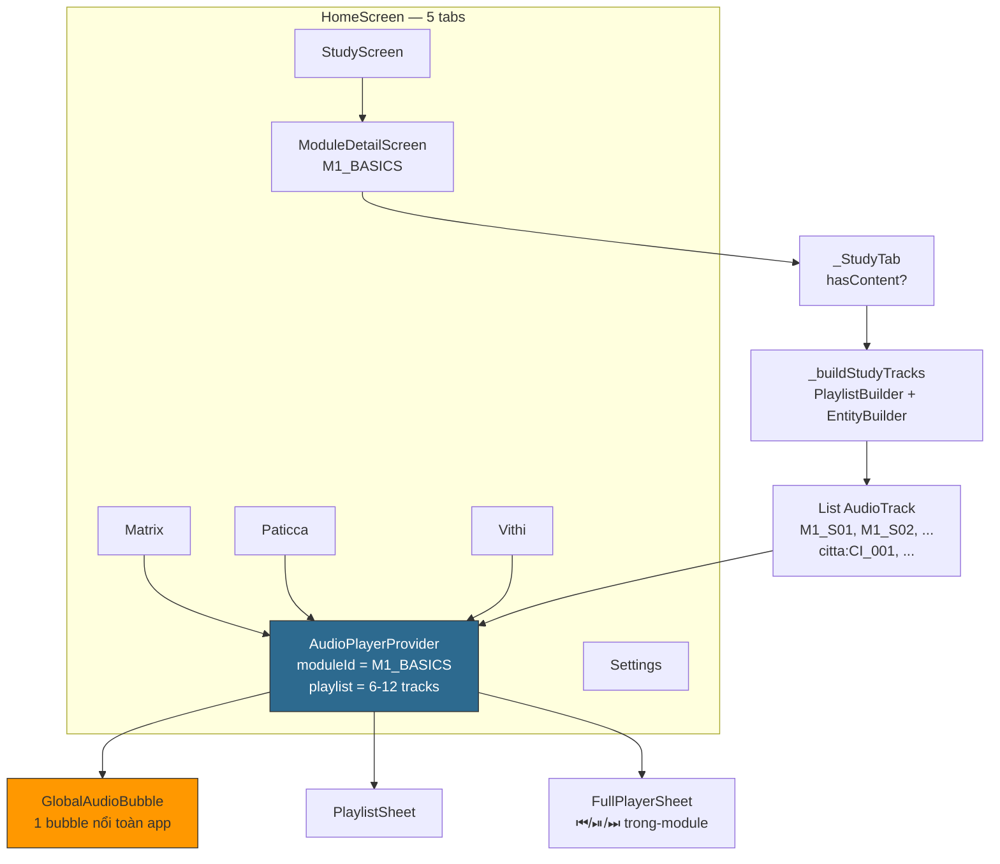
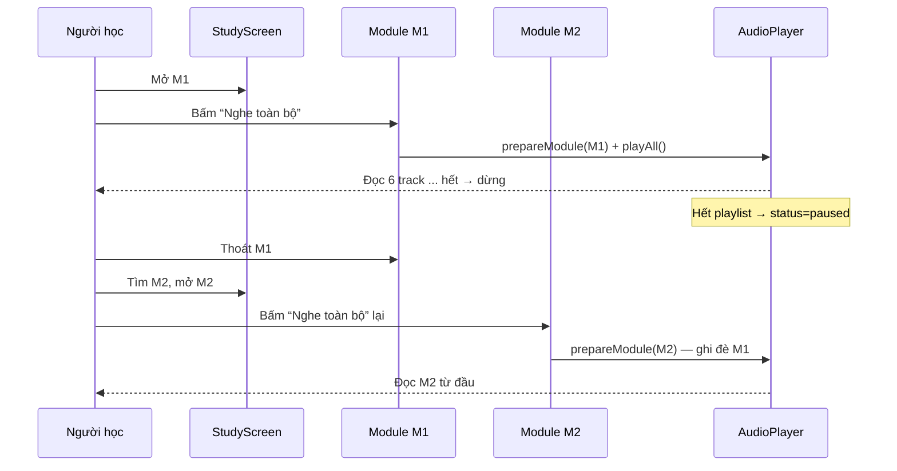
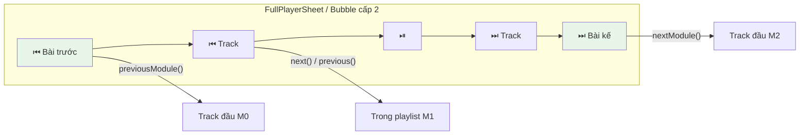
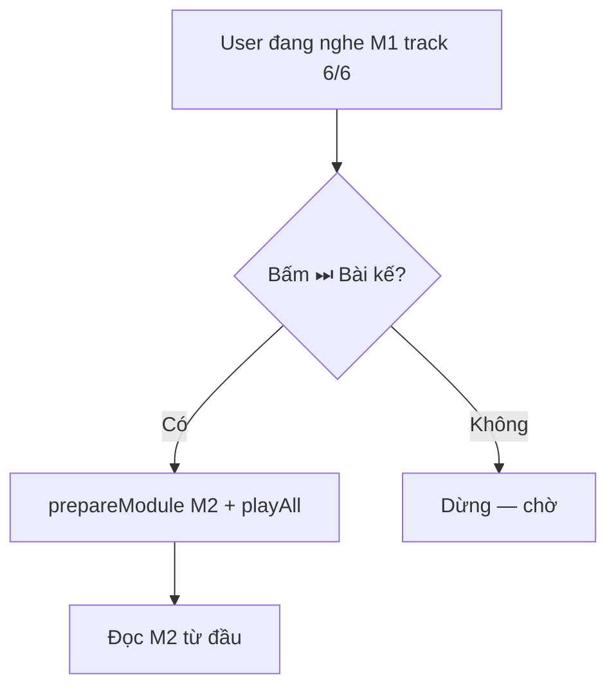
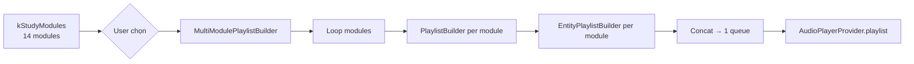
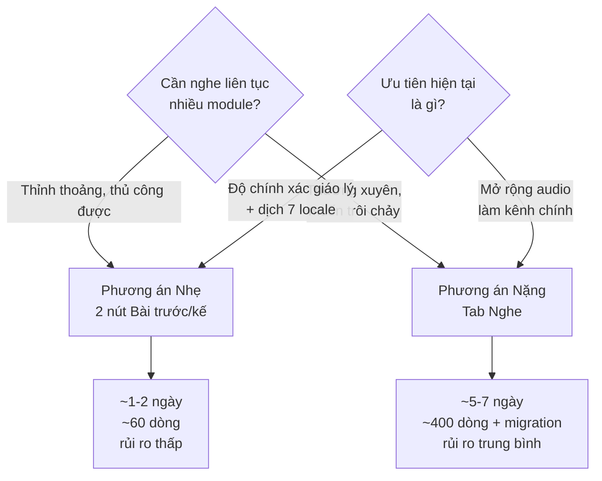
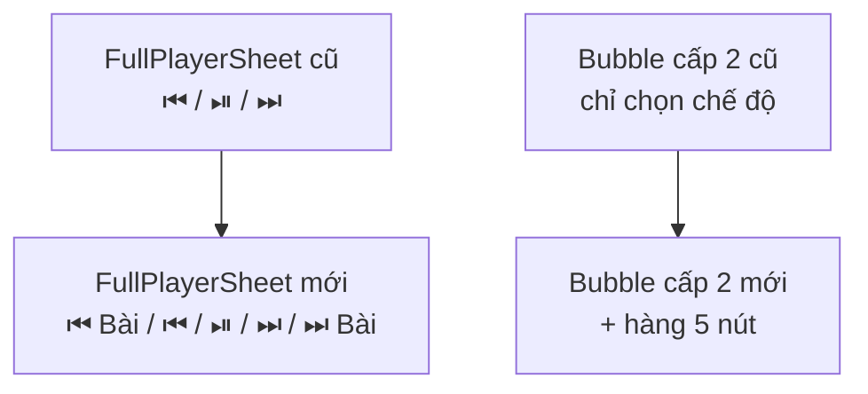

# VDP — Đặc tả Tab Nghe: Có cần “Phát nhiều bài + Tiến/Lùi”?

> **Ngữ cảnh:** Bạn gửi nhầm yêu cầu “Tab nghe phát nhiều bài + nút tiến/lùi” (vốn hợp cho app podcast/nhạc). File này **đánh giá lại trong bối cảnh VDP** — app Vi Diệu Pháp — và đặc tả bằng sơ đồ để bạn quyết định.

---

## 1. Khẳng định: VDP **không phải app nghe liên tục**

| Đặc trưng VDP | Khác với Spotify/YouTube |
|---|---|
| **Học theo module rời rạc** (M1: 7 Biến Hành → M2: Si Phần → … → M10: Lộ trình) | Nhạc/podcast là stream liên tục |
| Mỗi module có **prerequisite** (đồ thị có hướng) | Playlist nhạc không có prerequisite |
| Người học cần **tập trung + ghi chép + tra bảng** (Matrix 121×52) | Nghe thụ động |
| Audio là **phương tiện tiếp cận (A11y)**, không phải kênh chính (Milestone 4, ưu tiên Trung bình) | Audio là sản phẩm chính |

**Kết luận sơ bộ:** *Nghe nhiều bài liên tiếp* có ích cho **ôn tập thụ động** (đi xe, làm việc nhà) nhưng **không phải nhu cầu cốt lõi** của VDP. Nên cân nhắc **phương án nhẹ** trước.

---

## 2. Sơ đồ hiện trạng

### 2.1 Kiến trúc Audio hiện tại (single-module)



**Giới hạn:**
- `prepareModule()` **ghi đè** playlist cũ → không queue được M1+M2.
- `previous()/next()` chỉ `index ±1` trong `playlist` hiện tại.
- Bubble chỉ hiện “Đang phát: M1 · 2/6” — không biết có bài kế ở M2.

### 2.2 Journey hiện tại — muốn nghe 3 bài



> 3 lần thao tác thủ công, mất vị trí M1, không liên tục.

---

## 3. Hai phương án

### 3.1 Phương án Nhẹ — Chỉ thêm nút Tiến/Lùi Bài (khuyến nghị)

**Thay đổi duy nhất:** Trong `FullPlayerSheet` và `GlobalAudioBubble` cấp 2, thêm 2 nút `⏮ Bài trước / ⏭ Bài kế`.



**Chi tiết:**
- `AudioPlayerState` thêm `queueModuleIds: List<String>` (được tính từ `kStudyModules` theo `recommendedOrder`).
- Khi `moduleId=M1_BASICS`, `nextModule()` = tìm `M1` trong `kStudyModules`, lấy `kStudyModules[i+1]` → `M11_BIET_CANH` → `prepareModule()` module đó và `playAll(resume:false)`.
- Không cần queue đa bài thật — chỉ điều hướng giữa các module theo thứ tự học.

**Ưu/Nhược:**

| Ưu | Nhược |
|---|---|
| ~60 dòng code, không thêm tab | Vẫn phải “nhảy” — không phát trôi chảy M1→M2 tự động |
| Giữ 5 tab hiện tại, không tăng phức tạp | Chưa có “Nghe liên tục 3 bài” |
| Phù hợp Milestone 4 (A11y) | Cần người học tự bấm “Bài kế” khi hết |



### 3.2 Phương án Nặng — Tab Nghe đa bài (full queue)

```mermaid
flowchart TD
    subgraph HomeScreen6 [HomeScreen — 6 tabs]
        T1[Ma trận]
        T2[Học]
        T3[Duyên]
        T4[Lộ tâm]
        T5[🎧 Nghe — MỚI]
        T6[Cài đặt]
    end

    T2 --> Sel{Chọn nhiều module}
    Sel -->|M1+M2+M3| Q[prepareQueue<br/>queueId=phase1<br/>tracks=24]
    Q --> Prov[AudioPlayerProvider<br/>queueModuleIds=[M1,M2,M3]]
    Prov --> Now[Now Playing<br/>M1_S01 — Phassa]
    Prov --> Queue[Queue list<br/>M1_S02, M1_S03, ..., M2_S01]

    Now --> Trans[⏮ Bài / ⏮ / ⏯ / ⏭ / ⏭ Bài]
    Trans --> Auto{Tự sang bài kế?}
    Auto -->|Hết M1| Queue
```

**Queue builder:**



**Ưu/Nhược:**

| Ưu | Nhược |
|---|---|
| Trải nghiệm trôi chảy như Spotify | +6 tab → chật, phải dịch 26 locale |
| Phù hợp người ôn tập thụ động lâu | +400 dòng + test + migration `queueId` |
| Có preset “Giai đoạn 1”, “Toàn bộ” | Tăng gánh QA (Milestone 1-3 đang ưu tiên Cao) |
| Lưu queue cross-session | Rủi ro regression TTS web (đã phức tạp) |

---

## 4. Ma trận quyết định



| Tiêu chí | Trọng số | Nhẹ (2 nút) | Nặng (Tab 6) |
|---|---:|---|---|
| Phù hợp Blueprint (học rời rạc) | 30% | ✅ 9/10 | 6/10 |
| Công sức / rủi ro | 25% | ✅ 9/10 | 5/10 |
| Giá trị A11y (nghe thụ động) | 20% | 6/10 | ✅ 9/10 |
| Bảo trì lâu dài | 15% | ✅ 9/10 | 6/10 |
| Đồng bộ Milestone 1-3 | 10% | ✅ 9/10 | 5/10 |
| **Tổng** | 100% | **8.4** | 6.3 |

---

## 5. Khuyến nghị của Lead Design/Eng

> **Không làm Tab Nghe đa bài ngay. Làm Phương án Nhẹ trước, đo lường, rồi quyết.**

**Lộ trình đề xuất:**

1. **Tuần này:** Thêm `⏮ Bài trước / ⏭ Bài kế` vào `FullPlayerSheet` + `GlobalAudioBubble` cấp 2 (giữ 5 tab, không phá gì). Ước 1 ngày.
2. **Đo lường 2 tuần:** Log `nextModule/prevModule` count (privacy-safe). Nếu >15% phiên nghe dùng → chứng tỏ nhu cầu trôi chảy thật.
3. **Sau đó:** Nếu dữ liệu ủng hộ, nâng lên Tab Nghe full queue (đã có spec `doc/audio_multi_lesson_plan.md` sẵn, chỉ việc bật).

**Lý do:** VDP đang ở Milestone 1-3 (ổn định + polish) — độ chính xác giáo lý và dịch thuật 7 locale quan trọng hơn “nghe như podcast”. Phương án nhẹ cho 80% giá trị với 15% công sức.

---

## 6. Đặc tả chi tiết Phương án Nhẹ (để duyệt)

### 6.1 Thay đổi provider

```dart
// audio_player_provider.dart — thêm
List<String> get orderedModuleIds =>
    kStudyModules.map((m) => m['id'] as String).toList();

String? _nextModuleId(String current) {
  final ids = orderedModuleIds;
  final i = ids.indexOf(current);
  if (i < 0 || i >= ids.length - 1) return null;
  return ids[i + 1];
}

Future<void> nextModule() async {
  final next = _nextModuleId(state.moduleId!);
  if (next == null) return;
  // Tìm StudyModule, build tracks như _buildStudyTracks() hiện có
  final mod = kStudyModules.firstWhere((m) => m['id'] == next);
  final tracks = buildTracksForModule(mod, context);
  await prepareModule(moduleId: next, ..., tracks: tracks);
  await playAll(resume: false);
}
// previousModule() tương tự
```

### 6.2 Thay đổi UI



- Widget reuse: `LessonTransportBar` (5 nút, 48dp, Semantics).
- Disable khi `hasNextModule==false` → opacity 0.35.
- Test mở rộng: `audio_player_test.dart` group “nextModule”.

### 6.3 Không đổi

- `audio_track.dart`, `playlist_builder.dart` — giữ nguyên.
- 5 tab `HomeScreen` — giữ nguyên.
- Lưu trữ — vẫn `ListeningPosition(moduleId)` cũ.

---

## 7. Nếu bạn vẫn muốn Nặng — spec đã sẵn

File `doc/audio_multi_lesson_plan.md` (đã push `4470343`) chứa full spec Tab Nghe 6 tabs + queue đa bài + transport 5 nút + migration. Chỉ cần đổi quyết định là bật ngay.

---

## 8. Câu hỏi cho bạn

1. Bạn chọn **Nhẹ (2 nút)** hay **Nặng (Tab 6)**?
2. Nếu Nhẹ: thứ tự “Bài kế” theo `recommendedOrder` hay `prerequisiteIds`?
3. Có cần log đo lường trước khi quyết Nặng không?

Trả lời 3 câu này, tôi triển khai ngay trong nhánh này.

