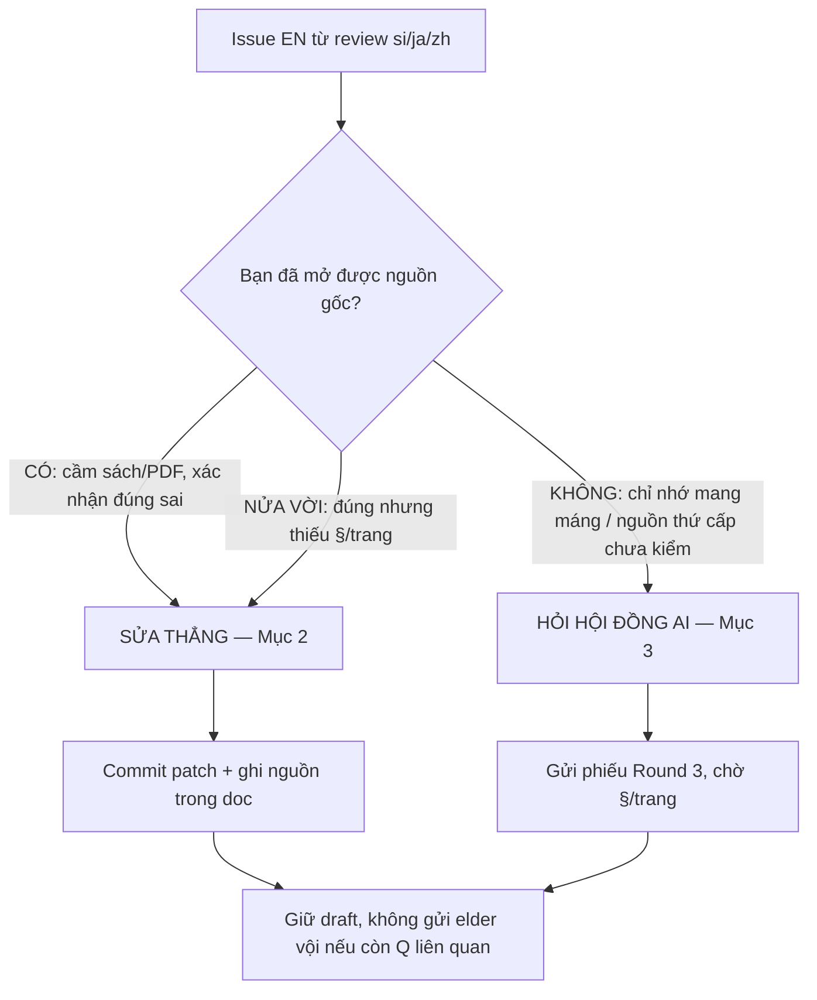

# Cách xử lý issue nguồn tiếng Anh: sửa thẳng vs. hỏi hội đồng AI

> Dành cho **project admin** — Áp dụng cho `assets/content/content_en.json` (English là nguồn, các locale `si`, `vi`, `hi`, `ja`, … chỉ fallback, không sửa ngược EN).  
> Trạng thái hiện tại: `draft` + `allowsEnglishFallback:true` (PSRC-37) — giữ cho tới khi elder ký. **Không bịa giáo lý, không gán số trang chưa mở.**

---

## 1. Quyết định nhanh: SỬA THẲNG hay HỎI HỘI ĐỒG?



**Quy tắc vàng:**
- **Chắc = sửa:** bạn hoặc 1 reviewer đã mở **Paṭṭhāna / Visuddhimagga / Saṅgaha / Narada Manual / SN** và trích được **số §, trang, bản dịch**. Ví dụ: KM_R_04 vừa sửa `phala-citta` vì Narada ch.5 ghi rõ lokuttara ≠ kamma.
- **Chưa chắc = hỏi:** chỉ có nguồn thứ cấp (pitaka.lk Chandrikava bản Sinhala chưa xác nhận), hoặc nhớ lơ mơ CMA §14 mà chưa mở — **không đoán số**. Ví dụ: PC_03 84 tâm đang ở vế nào.

---

## 2. Trường hợp CHẮC — Sửa thẳng (như 3 issue vừa push `ec83ecd`)

### 2.1. Checklist trước khi sửa
- [ ] Xác định **key JSON**: `kammas.KM_R_04.doctrinalNote` / `vithis.VT_VITHIMUTTA.steps[2]` / `rupas.RP_022` …
- [ ] Ghi lại **nguồn đã mở**: tên sách, chương, §/trang, bản dịch (ví dụ: `Narada ch.5, CMA VIII §14/Table 8.4`)
- [ ] Chỉ sửa **1 field** liên quan, không đổi cấu trúc (không thêm `subdivisions` mới nếu thuộc IN4-55)
- [ ] Chạy `python3 -m json.tool assets/content/content_en.json > /dev/null` — phải valid
- [ ] Không chạm `content_si.json` / `content_ja.json` … — để fallback EN tự lo

### 2.2. Mẫu commit & PR (copy-paste)

**Commit:**
```
fix(content-en): correct KM_R_04 per Narada ch.5

- doctrinalNote: path ≠ kamma, result is phala-citta with Nibbana as object
- source: Narada Manual of Abhidhamma ch.5 p.XX; CMA VIII §YY
- en-only fix, si/ja kept draft + fallback
```

**PR description:**
```md
EN source fix (si review 44c36 #1)

- Before: "produces Nibbana as result"
- After: "not kamma nor vipaka; result is phala-citta (Narada ch.5)"
- Verified: [link/PDF page]
- No si change, draft retained
```

### 2.3. Ví dụ đã làm (bạn có thể bắt chước)

| Issue | Trước | Sau | Nguồn ghi trong JSON/doc |
|-------|-------|-----|---------------------------|
| KM_R_04 | `produces Nibbana` | `not kamma nor vipaka; result is phala-citta with Nibbana as object (Narada ch.5)` | `Narada ch.5` trong note |
| RP_022 | `Depends on present health` | `produced by citta/utu/ahara only (Sangaha ch.6 §31)` | `Sangaha ch.6` |
| VT_VITHIMUTTA | `bhavaṅga` 1 dòng | `bhavaṅga + calana + upaccheda (Chandrikava 5-9)` | `Chandrikava 5-9 ed. unconfirmed` |

---

## 3. Trường hợp CHƯA CHẮC — Soạn phiếu hỏi hội đồng AI

Dùng khi: bạn **chưa mở** Paṭṭhāna/Saṅgaha/CMA, hoặc nguồn chỉ là bản dịch thứ cấp, hoặc cần elder phán.

### 3.1. Template phiếu Round 3 (đã dùng cho PC_03 Q4 bản sửa)

> **Q4 (bản sửa).** PC_03 `paccayuppanna` ghi "với cảnh trưởng là 84 tâm (trừ tâm quả vô nhân...) và tâm sở tương ưng"; `paccayaDhamma` chỉ ghi "cảnh trưởng (cảnh được coi trọng)" không có số.
> (a) Theo Saṅgaha Paccayapariccheda và CMA Ch.VIII §14/Table 8.4, vế **năng duyên** (cảnh được trọng) và vế **sở duyên** (tâm trọng cảnh) của ārammaṇādhipati mỗi vế gồm bao nhiêu tâm, tâm sở và pháp nào? Số §/trang.
> (b) Danh sách loại trừ đầy đủ đằng sau "trừ ... " là gì?
> (c) 84 thuộc vế nào?
> Không mở được nguồn thì ghi `KHÔNG XÁC MINH ĐƯỢC`. Không đoán số.

**Quy tắc phiếu:**
- Mỗi câu hỏi **1 vế + 1 nguồn yêu cầu §/trang** (không hỏi gộp 3 sách).
- Bắt buộc có dòng: `Không mở được nguồn thì ghi KHÔNG XÁC MINH ĐƯỢC.`
- Không gợi ý đáp án (tránh "28 hay 84?" khi chưa rõ vế).

### 3.2. Template cho issue khác (copy-sửa)

**PC_02 attribution:**
> PC_02 `doctrinalNote` ghi "According to Visuddhimagga XVII, ignorance serves as object condition …". (a) Vism XVII § nào xác nhận? (b) Nếu không, Chandrikava 9-12 ghi gì? Trích nguyên văn + §/trang. Không có thì ghi KHÔNG XÁC MINH ĐƯỢC.

**KM_R_01 incomplete:**
> KM_R_01 `doctrinalNote` "ripens within woeful planes" — Akusala kamma ngoài paṭisandhi 4 ác thú còn cho quả gì trong pavatti (7 ahetuka vipāka)? Nguồn Nārada/Saṅgaha § nào?

**Q10/Q6 tương tự:** giữ nguyên mẫu Q6/Q10 trong `round2_consensus_v2.md` Mục IV.

### 3.3. Gửi cho ai, gửi ở đâu?
1. Tạo Linear issue `PSRC-xx / IN4-xx` label `DOCTRINE-L10N` — dán phiếu + link `content_en.json` key.
2. Tag 4 thành viên hội đồng: `C/M/G/R` (Claude/Muse/Gemini/RedTeam) — mỗi người trả lời **chỉ khi mở được sách**, kèm ảnh/PDF.
3. Đợi đủ 3/4 có §/trang mới đưa vào `verdict_sheet_elder_v2.md`. Trong lúc chờ, **không gửi elder** (đúng chỉ đạo mục 4 của PC_03).

---

## 4. Sau khi có kết quả

- **Nếu hội đồng đồng thuận (≥3/4) + có §/trang:** admin áp dụng như Mục 2, ghi nguồn vào `sourceRefs` hoặc `doc/english_source_issues_si_review_...md`.
- **Nếu không đủ nguồn:** ghi `KHÔNG XÁC MINH ĐƯỢC` trong `verdict_sheet`, để EN như cũ, đánh dấu `needs_senior_review` (như `paccayas.json reviewStatus`).
- **Không bao giờ** đẩy EN sang `reviewed` chỉ vì coverage 16–26% — phải có ký elder.

---

## 5. Ví dụ quyết định cho 10 issue si vừa rồi

| # | Bạn có chắc? | Hành động |
|---|--------------|-----------|
| 1 KM_R_04 | CÓ (Narada ch.5) | ✅ Sửa thẳng — đã push |
| 2 VT_VITHIMUTTA calana | CÓ (Chandrikava 5-9) | ✅ Sửa thẳng — đã push |
| 8 RP_022 citta/utu/ahara | CÓ (Sangaha ch.6 §31) | ✅ Sửa thẳng — đã push |
| 3 KM_R_01 | Chưa (thiếu nguồn đầy đủ) | ❓ Hỏi hội đồng — phiếu KM_R_01 |
| 4 PC_02 Vism XVII | Chưa (chưa mở Vism) | ❓ Hỏi — phiếu PC_02 |
| 5 PC_03 18 rootless | Chưa | ❓ Hỏi — phiếu PC_03 |
| 6 PC_12 path≠āsevana | Nửa vời | Hỏi để lấy §, có thể sửa sau |
| 7 PD_11 birth↔viññāṇa | Chưa (secondary Vism) | ❓ Hỏi |
| 9 shortName 71 trùng | Không phải giáo lý | Admin quyết, không cần hội đồng |
| 10 VT citta numbers | Chưa kiểm | Ghi UNVERIFIED, không sửa |

---

**Kết:** Chắc thì sửa 1 field + ghi nguồn + valid JSON; chưa chắc thì dán 1 trong các template phiếu trên vào Linear/ROUND3, đợi §/trang rồi mới sửa. Toàn bộ EN fix đều **không đụng si**, giữ `draft` + fallback cho tới elder ký.
